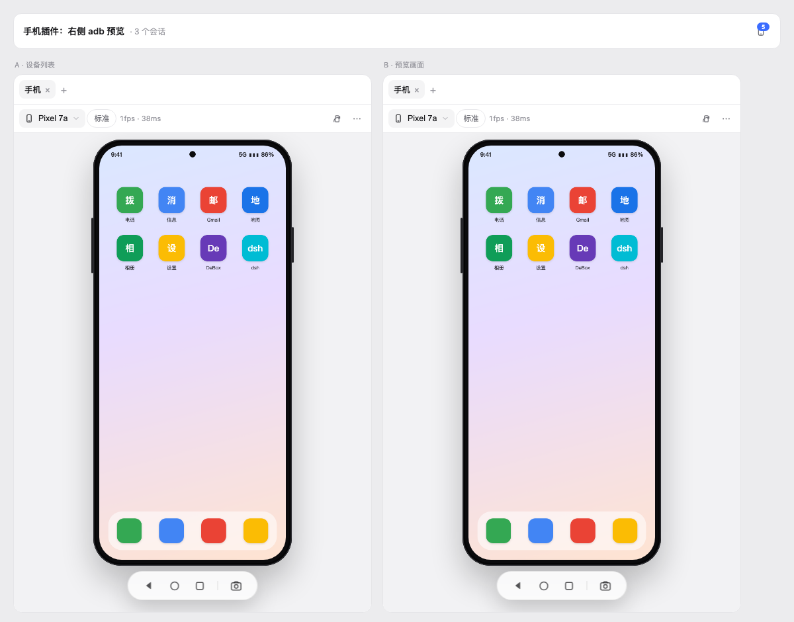

# dsh-phone

[](https://www.npmjs.com/package/@ponydev/dsh-phone)
[](LICENSE)

DSH Web 插件：在右侧栏预览已连接的 Android 设备，点画面就是点手机。



## 功能

- **会话头部手机图标**：点一下展开右侧栏，角标显示在线设备数。
- **设备列表**：平铺一列，不按手机类型分组；图标按设备系统显示（Android / HarmonyOS / iOS），旁边两个小标签分别标连接方式（USB / Wi-Fi / Tailscale / emulator）和系统（Android / HarmonyOS / iOS），状态点区分 `device` / `unauthorized` / `offline` / `已保存`。
- **预览**：H.264 流（`screenrecord` → WebCodecs → canvas），约 20–30fps；不支持 WebCodecs 时自动回退截图轮询。打开面板会自动进入预览（本会话上次设备 → 第一台在线设备）。
- **点按**：点击 = `tap`，拖拽 = `swipe`（坐标按 `wm size` 的设备像素换算，和流分辨率无关）。
- **操作栏**：底部是「返回 / 主页 / 多任务 | 截图」，顶部只有设备下拉、旋转、更多。
- **连接**：`adb connect <ip>:<port>`（无线调试、Tailscale 云手机）；连接过的目标自动记到 `$DSH_HOME/phone/targets.json`，未连接时也显示在列表里，点一下就直接连。
- **诊断**：`⋯ → adb 诊断` 看 adb 路径/版本、每台设备状态，一键复制。
- **更多**：电源、旋转、重新连接、adb 诊断、浮窗打开、复制 serial、断开。
- 连接方式由 serial 判断：`usb:` 属性 → USB；`*.ts.net` 或 `100.64.0.0/10` → Tailscale；其余带端口 → Wi-Fi。
- 系统平台由 `getprop` 判断（`ro.build.version.harmony*` / `hw_sc.build.platform.version` → HarmonyOS，其余 Android）；iOS 图标等接入 WDA transport 后生效。
- 没有分辨率/网速元数据栏，没有文字输入框。

## 安装

```sh
# 本地开发（link 到当前 clone）
dsh plugin --profile web add link:~/deepseek/plugins/dsh-phone

# 从 npm（发布后）
dsh plugin --profile web add @ponydev/dsh-phone
```

装完重启 `dsh web`。右侧栏 tab 类型和头部图标在重启后的页面里出现。

## 配置

`cordis.patch.yml` 里可以覆盖：

```yaml
- insert:
    - id: phone
      name: "@ponydev/dsh-phone"
      config:
        adbPath: adb   # 或 ~/Library/Android/sdk/platform-tools/adb
        pollMs: 700
        streamTimeLimit: 180   # screenrecord 单次上限，到点自动续
        streamBitRate: 6000000 # 客户端清晰度会覆盖这两项
        streamSize: 540x1200
```

客户端清晰度预设（顶部切换，**按设备 serial 分别记忆**）：

| 档位 | 目标短边 | bitrate | Pixel 1080x2400 | 云手机 720x1280 | 云手机 1256x2584 |
|---|---|---|---|---|---|
| 流畅 | 360 | 2 Mbps | 360x800 | 360x640 | 360x740 |
| 标准 | 540 | 6 Mbps | 540x1200 | 540x960 | 540x1110 |
| 高清 | 720 | 10 Mbps | 720x1600 | 720x1280 | 720x1482 |

输出尺寸按设备**实际显示分辨率**等比计算（`wm size` 优先取 Override size），不会把 9:20 的比例硬套到别的手机。
```

`adb` 查找顺序：`adbPath` → `PATH` → `$ANDROID_HOME/platform-tools/adb` → `$ANDROID_SDK_ROOT/platform-tools/adb` → `~/Library/Android/sdk/platform-tools/adb` → `/opt/homebrew/bin/adb`。

## 接口

Host 半区挂 `/phone` 前缀（`webServer.register` + `connection.admit` 认证围栏），纯 JSON：

| 接口 | 说明 |
|---|---|
| `POST /phone/health` | adb 路径/版本、设备数 |
| `POST /phone/devices` | `adb devices -l` 解析结果 |
| `POST /phone/connect` | `{ address }` |
| `POST /phone/disconnect` | `{ serial }` |
| `POST /phone/shot` | `{ serial }` → `image/png` 原始字节 |
| `POST /phone/input` | `{ serial, event }`，event 支持 `tap` / `swipe` / `key` / `rotate` |
| `POST /phone/stream` | `{ serial }` → `video/h264` chunked Annex-B 流 |
| `POST /phone/screen-info` | `{ serial }` → `{ width, height }`（`wm size`） |
| `POST /phone/targets` | 已保存的连接目标（最近 12 条，含 pinned/lastSeenAt） |
| `POST /phone/targets/remove` | `{ address }` |

成功 `{ ok: true, value }`，失败 `{ ok: false, error: { code, message } }`。

## 安全

- 所有 adb 调用 `execFile` + 参数数组，不经过 shell。
- serial 必须出现在最新 `adb devices -l` 里才允许 `shot` / `input`；`connect` 地址走 `host:port` 正则。
- 不暴露任意 `adb shell` 命令。
- 路由复用 DSH 的 Host/Origin + Cookie 认证，未认证返回 401。

## 关于右侧栏宽度

DSH 右侧栏第一次打开是**视口宽度的 45%**（1440 屏 ≈ 648px），之后记住你拖出来的像素宽度；这是 frame 级设置，**插件没有 API 改**。

而手机画面是按高度等比缩放的，1440×900 下大约 361px 宽 —— 所以默认宽度下画面两侧会有留白。两个办法：

1. 手动把右侧栏拖窄一次（DSH 会记住）；
2. 打开手机后点 `⋯ → 浮窗打开`，插件会按画面宽度算一个 `324–361px` 的浮窗并放到右侧。

## 操作布局

```
[ Pixel 7a ▾ ]                     [旋转] [⋯]
────────────────────────────────────────────
              （设备画面）
────────────────────────────────────────────
      [←] [○] [□]   │   [📷]
```
- 底部：返回 / 主页 / 多任务，右侧分隔后是截图。
- 顶部：设备下拉、旋转、更多（电源、重连、诊断、浮窗、复制 serial、设备列表）。
- 「断开连接」放在设备下拉菜单里，需要点两次确认（防止误触）。

## 平台支持

| 平台 | 后端 | 画面 | 操作 | 创建 |
|---|---|---|---|---|
| Android 真机 / 云手机 | adb（USB / TCP / Tailscale） | H.264 20–30fps | tap / swipe / 按键 | — |
| iOS 模拟器 | `xcrun simctl` + idb（可选） | 截图轮询 1–2fps；装 idb 后 H.264 | 装 idb 后 tap / swipe / 按键 | ✅ 选择机型 + 运行时 |
| HarmonyOS 模拟器 | DevEco `Emulator` CLI | 截图轮询 1–2fps | tap / swipe / 旋转 / 电源 / 按键 / 文字 | ✅ 选择系统镜像 |
| HarmonyOS 真机 | hdc | 截图轮询 1–2fps | tap / swipe / 按键 / 文字 | — |

- iOS 依赖 macOS + Xcode；实时画面/输入需要 `idb`（`brew install facebook/fb/idb-companion` + `pip install fb-idb`），未装时只读预览。
  - 如果 Homebrew 报 "Xcode alone is not sufficient on Tahoe"（需要 Command Line Tools），可改用官方 release 手工安装：
    `gh release download v1.7.7 --repo facebook/idb --pattern 'idb-companion.macos-arm64.tar.gz'`，解压到 `~/.local/lib/idb-companion`，
    再把 `idb_companion` / `idb-repl` 软链到 `~/.local/bin`；客户端 `python3 -m venv ~/.local/venvs/fb-idb && ~/.local/venvs/fb-idb/bin/pip install fb-idb`。
- HarmonyOS 依赖 DevEco Studio（`Emulator` CLI）与 `hdc`；hdc 没有 screenrecord，只能截图轮询。
- 物理 iPhone / iPad 不支持（Apple 未公开投屏/注入 API，Claude Code Desktop 也只支持模拟器）。

## 验证状态

- **iOS 模拟器**（iPhone Air / iOS 26.5）：create / boot / 截图 / idb H.264 流 / tap / Home 实测通过；像素→point 坐标换算用真实弹窗验证。
- **HarmonyOS 模拟器**（HarmonyOS 7.0.0）：create / start / 截图 / tap / swipe / rotate / stop / delete 全链路实测通过。
- **HarmonyOS 真机**（Mate 60 Pro，hdc）：截图 / keyEvent / tap / text 实测通过。
- **Android**：真机与云手机的 tap / swipe / back / home / 截图 / H.264 流实测通过。

## 已知限制

- Android 画面默认走 H.264 流（约 20–30fps）；没有 WebCodecs 的浏览器会回退到 1–2fps 轮询截图。
- Android 流是 `screenrecord`，没有声音；单次 180s 上限由 Host 自动续接（断开 <1s）。
- 单个右侧栏 tab，设备在 tab 内切换；不支持同一 pane 多设备并排（后续可开 `multiple`）。
- Android 文字输入（`adb shell input text` 只支持 ASCII，中文要 ADBKeyboard）；鸿蒙用 `uitest uiInput text`。
- 「已保存」目标是地址级记录，没有备注名；显示名直接是 `ip:port` / 主机名。
- 右侧栏是 per-session 的，没有会话的页面不显示手机图标。
- Android 需要设备上已授权 USB 调试；`unauthorized` 会提示去手机上点允许。

## 开发

```sh
npm run check        # 语法 + i18n + 隐私/截图门禁
npm run smoke        # 解析/白名单/真机 adb 冒烟
npm run smoke:hos    # 鸿蒙 Emulator CLI / hdc 只读冒烟（需要 DevEco）
node scripts/render-test.mjs [screenshot.png]
                     # 离线渲染列表 + 预览，输出 /tmp/dsh-phone-render.html/.png
```

`scripts/render-test.mjs` 默认用 `/tmp/dsh-phone-shot.png` 作为画面占位。本地调试可以用真机截图，
但**提交进 docs 的截图必须用合成占位图**（真机截图只放 /tmp，不进仓库）。

## 结构

```
lib/index.js      Host：/phone 路由、认证围栏、按 transport 分发
lib/adb.js        Android：adb 定位 / devices 解析 / 截图 / 输入 / 串行化
lib/ios.js        iOS 模拟器：simctl 生命周期/创建/截图 + idb 实时流/输入
lib/hos.js        HarmonyOS：DevEco Emulator CLI + hdc（真机）
lib/transport.js  PhoneTransport 接口 + AdbTransport
lib/client.js     ModuleLoader bundle：tab 类型、列表、预览、i18n、样式
cordis.patch.yml  bundle 补丁
scripts/          smoke + 离线渲染
docs/             DESIGN.md、mockup、截图
```

## License

MIT
