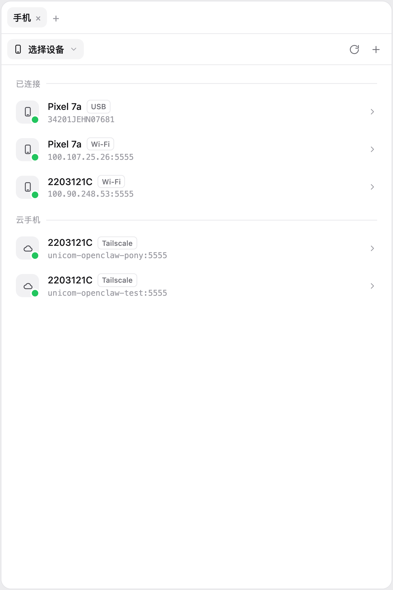
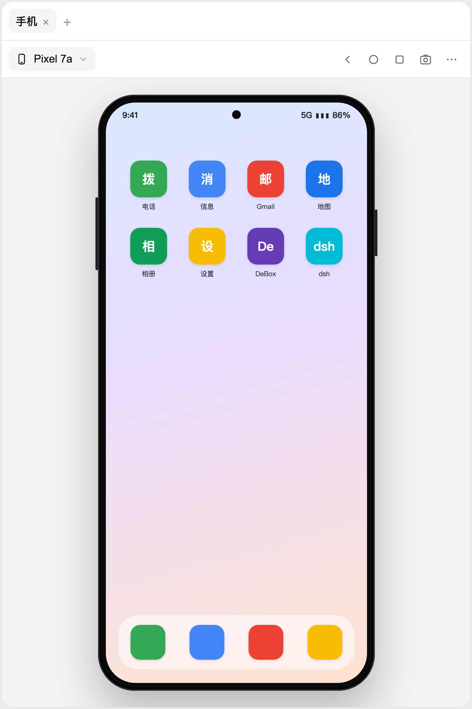
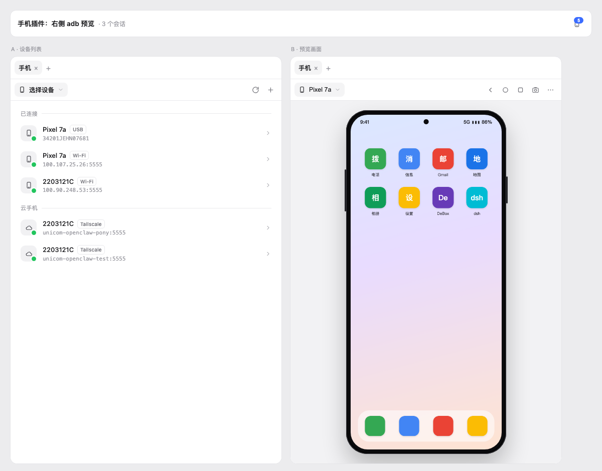

# dsh-phone

DSH Web 插件：在右侧栏预览已连接的 Android 设备，点画面就是点手机。

| 设备列表 | 预览画面 |
|---|---|
|  |  |



## 功能

- **会话头部手机图标**：点一下展开右侧栏，角标显示在线设备数。
- **设备列表**：USB / Wi-Fi / 模拟器 / 云手机分组，状态点区分 `device` / `unauthorized` / `offline`。
- **预览**：设备画面按右侧栏高度等比缩放，带机身 bezel；顶栏只有「设备下拉 + 返回/主页/多任务/截图/更多」。
- **点按**：点击 = `tap`，拖拽 = `swipe`（坐标按截图实际像素换算）。
- **连接**：`adb connect <ip>:<port>`（无线调试、Tailscale 云手机）。
- **更多**：电源、旋转、重新连接、浮窗打开、复制 serial、断开。
- 没有分辨率/网速元数据栏，没有文字输入框。

## 安装

```sh
# 本地开发（link 到当前 clone）
dsh plugin --profile web add link:/Users/pony/deepseek/plugins/dsh-phone

# 从 npm（发布后）
dsh plugin --profile web add dsh-phone
```

装完重启 `dsh web`。右侧栏 tab 类型和头部图标在重启后的页面里出现。

## 配置

`cordis.patch.yml` 里可以覆盖：

```yaml
- insert:
    - id: phone
      name: dsh-phone
      config:
        adbPath: adb   # 或 /Users/pony/Library/Android/sdk/platform-tools/adb
        pollMs: 700
```

`adb` 查找顺序：`adbPath` → `PATH` → `$ANDROID_HOME/platform-tools/adb` → `$ANDROID_SDK_ROOT/platform-tools/adb` → `~/Library/Android/sdk/platform-tools/adb` → `/opt/homebrew/bin/adb`。

## 接口

Host 半区挂 `/phone` 前缀（`webServer.register` + `connection.admit` 认证围栏），纯 JSON：

| 接口 | 说明 |
|---|---|
| `POST /phone/health` | adb 路径/版本、设备数 |
| `POST /phone/devices` | `adb devices -l` 解析结果 |
| `POST /phone/connect` | `{ address }` |
| `POST /phone/disconnect` | `{ serial }` |
| `POST /phone/shot` | `{ serial }` → `image/png` 原始字节 |
| `POST /phone/input` | `{ serial, event }`，event 支持 `tap` / `swipe` / `key` / `rotate` |

成功 `{ ok: true, value }`，失败 `{ ok: false, error: { code, message } }`。

## 安全

- 所有 adb 调用 `execFile` + 参数数组，不经过 shell。
- serial 必须出现在最新 `adb devices -l` 里才允许 `shot` / `input`；`connect` 地址走 `host:port` 正则。
- 不暴露任意 `adb shell` 命令。
- 路由复用 DSH 的 Host/Origin + Cookie 认证，未认证返回 401。

## 关于右侧栏宽度

DSH 右侧栏第一次打开是**视口宽度的 45%**（1440 屏 ≈ 648px），之后记住你拖出来的像素宽度；这是 frame 级设置，**插件没有 API 改**。

而手机画面是按高度等比缩放的，1440×900 下大约 361px 宽 —— 所以默认宽度下画面两侧会有留白。两个办法：

1. 手动把右侧栏拖窄一次（DSH 会记住）；
2. 打开手机后点 `⋯ → 浮窗打开`，插件会按画面宽度算一个 `324–361px` 的浮窗并放到右侧。

## 已知限制

- 画面是 **轮询截图**（约 1–2 fps），不是视频流；高帧率版（`screenrecord` H.264 + WebCodecs）在计划里。
- 单个右侧栏 tab，设备在 tab 内切换；不支持同一 pane 多设备并排（后续可开 `multiple`）。
- 没有文字输入（`adb shell input text` 只支持 ASCII，中文要 ADBKeyboard）。
- 只支持 Android/adb；hdc（鸿蒙）和 iOS 走 `PhoneTransport` 接口后加。
- 右侧栏是 per-session 的，没有会话的页面不显示手机图标。
- 需要设备上已授权 USB 调试；`unauthorized` 会提示去手机上点允许。

## 开发

```sh
npm run check        # node --check 四个 lib 文件
npm run smoke        # 解析/白名单/真机 adb 冒烟
node scripts/render-test.mjs [screenshot.png]
                     # 离线渲染列表 + 预览，输出 /tmp/dsh-phone-render.html/.png
```

`scripts/render-test.mjs` 默认用 `/tmp/dsh-phone-shot.png` 作为画面占位；可以先用
`adb -s <serial> exec-out screencap -p > /tmp/dsh-phone-shot.png` 生成。

## 结构

```
lib/index.js      Host：/phone 路由、认证围栏、错误映射
lib/adb.js        adb 定位 / devices 解析 / 截图 / 输入 / 串行化
lib/transport.js  PhoneTransport 接口 + AdbTransport（hdc / iOS 后加）
lib/client.js     ModuleLoader bundle：tab 类型、列表、预览、i18n、样式
cordis.patch.yml  bundle 补丁
scripts/          smoke + 离线渲染
docs/             设计文档与截图
```

## License

MIT
